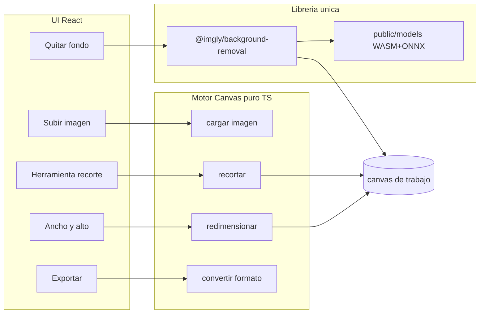
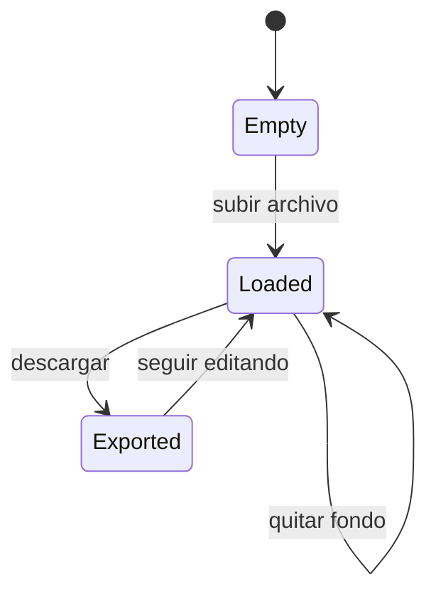

# Plan: Editor de imágenes con Canvas API

## Contexto actual

El proyecto en [`images-editor/`](images-editor/) es una plantilla Vite + React 19 + TypeScript sin lógica de edición. Solo dependencias de runtime: `react` y `react-dom`. Se reemplazará el contenido de [`src/App.tsx`](images-editor/src/App.tsx) por el editor.

## Arquitectura



**Principio clave:** toda la lógica de píxeles vive en módulos TypeScript sin React (`src/lib/`). React solo orquesta UI y estado.

## Dependencias

| Área | Solución | Librerías nuevas |
|------|----------|------------------|
| Recorte | `drawImage` con rectángulo fuente/destino | Ninguna |
| Redimensionar | Canvas con ancho/alto independientes (sin forzar proporción) | Ninguna |
| Exportar | `canvas.toBlob()` → PNG / JPEG / WebP | Ninguna |
| Quitar fondo | `@imgly/background-removal` (ONNX + WASM en navegador) | **1 sola** |

### Despliegue sin instalar nada en producción

- `pnpm build` genera `dist/` con HTML, JS, CSS y assets.
- Los modelos WASM/ONNX se descargan **una vez en desarrollo/CI** con un script (`scripts/setup-models.mjs`) y se copian a [`public/models/`](images-editor/public/models/).
- En runtime se configura `publicPath: '/models/'` para no depender de CDN externo (importante en red bancaria).
- La librería de fondo se importa con `import()` dinámico (lazy) para no cargar ~15–25 MB hasta que el usuario pulse "Quitar fondo".

> **Licencia:** `@imgly/background-removal` es AGPL-3.0. Para uso interno del banco conviene validar con el equipo legal; si no es viable, el plan reserva un adaptador en `removeBackground.ts` para cambiar de proveedor sin tocar el resto.

## Estructura de archivos propuesta

```
src/
  lib/
    imageCanvas.ts      # crear canvas, cargar File/Blob/ImageBitmap
    crop.ts             # aplicar recorte a partir de rect {x,y,w,h}
    resize.ts           # redimensionar a width/height libres
    export.ts           # toBlob + descarga (PNG/JPEG/WebP + calidad)
    removeBackground.ts # wrapper lazy de @imgly/background-removal
    types.ts            # ImageRect, ExportFormat, EditorState
  hooks/
    useImageEditor.ts   # useReducer: imagen actual, herramienta, historial básico
  components/
    ImageEditor.tsx     # layout principal
    CanvasViewport.tsx  # canvas visible + overlay de recorte
    Toolbar.tsx         # selector de herramienta
    CropOverlay.tsx     # rectángulo arrastrable/redimensionable (mouse)
  panels/
    ResizePanel.tsx     # inputs numéricos ancho/alto + botón Aplicar
    ExportPanel.tsx     # selector formato, calidad JPEG/WebP, Descargar
    BackgroundPanel.tsx # botón quitar fondo + indicador de progreso
  App.tsx               # reemplazar plantilla Vite
  App.css / index.css   # estilos del editor (layout 2 columnas)
public/
  models/               # WASM + ONNX (generado por script, no en git)
scripts/
  setup-models.mjs      # descarga package.tgz de imgly y extrae a public/models
```

## Implementación por funcionalidad

### 1. Carga de imagen

- Input `type="file"` con `accept="image/*"`.
- `URL.createObjectURL(file)` → `HTMLImageElement` → dibujar en canvas de trabajo.
- Mostrar dimensiones originales en la barra lateral.

### 2. Recortar (Canvas API)

- Overlay semitransparente sobre el canvas con un rectángulo de selección (arrastrar esquinas y mover).
- Coordenadas en espacio de imagen (escalar según zoom de vista previa).
- Al aplicar: nuevo canvas con `ctx.drawImage(img, sx, sy, sw, sh, 0, 0, sw, sh)`.
- Validar mínimo 1×1 px y que el rect esté dentro de los límites.

### 3. Redimensionar (ancho y alto libres)

- Dos inputs numéricos independientes (sin checkbox de "mantener proporción").
- Botón **Aplicar**: `canvas.width = newW`, `canvas.height = newH`, `drawImage` escalando (puede deformar si el usuario lo desea).
- Vista previa actualizada al instante tras aplicar.

### 4. Convertir y exportar formatos

- Selector: **PNG** (transparencia), **JPEG**, **WebP**.
- Slider de calidad (0.1–1.0) visible para JPEG/WebP.
- `canvas.toBlob(mimeType, quality)` → `URL.createObjectURL` → `<a download>`.
- Nombre de archivo derivado del original + sufijo de formato.

### 5. Eliminar fondo (`@imgly/background-removal`)

Wrapper en [`removeBackground.ts`](images-editor/src/lib/removeBackground.ts):

```typescript
const { default: removeBackground } = await import('@imgly/background-removal')

const blob = await removeBackground(imageBlob, {
  publicPath: `${import.meta.env.BASE_URL}models/`,
  model: 'isnet_quint8', // más liviano; buen balance tamaño/calidad
  output: { format: 'image/png', type: 'foreground' },
})
```

- Entrada: `Blob` del canvas actual.
- Salida: `Blob` PNG con transparencia → redibujar en canvas de trabajo.
- UI: spinner + mensaje "Procesando…" (puede tardar varios segundos en CPU).
- Script `pnpm setup:models` en [`package.json`](images-editor/package.json) para poblar `public/models/` antes del primer uso o en CI.

### 6. Configuración Vite

En [`vite.config.ts`](images-editor/vite.config.ts):

- `build.rollupOptions.output.manualChunks` para aislar `@imgly/background-removal` en un chunk separado.
- Asegurar que archivos en `public/models/` se copian tal cual a `dist/models/`.

## UI propuesta

Layout de dos columnas:

- **Izquierda:** canvas con checkerboard de fondo (para ver transparencia) + overlay de recorte cuando la herramienta activa es "Recortar".
- **Derecha:** toolbar vertical (Recortar | Redimensionar | Quitar fondo | Exportar) + panel contextual según herramienta.
- Barra superior: botón "Subir imagen", dimensiones actuales, botón "Deshacer" (1 paso atrás en historial de canvas).

Estilo: reutilizar variables CSS existentes en [`index.css`](images-editor/src/index.css), tono profesional apto para entorno corporativo.

## Flujo de estado (`useImageEditor`)



- Guardar historial como stack de `ImageData` o `Blob` (máx. 10 pasos) para deshacer.
- Cada operación destructiva actualiza el canvas de trabajo y empuja al historial.

## Scripts npm

```json
{
  "setup:models": "node scripts/setup-models.mjs",
  "predev": "node scripts/setup-models.mjs",
  "dev": "vite",
  "build": "tsc -b && vite build"
}
```

`predev` opcional: avisa si faltan modelos. En CI, ejecutar `pnpm setup:models && pnpm build` antes de publicar `dist/`.

## Tareas de implementación

1. Crear módulos en `src/lib/` (`imageCanvas`, `crop`, `resize`, `export`, `removeBackground`, `types`).
2. Añadir `@imgly/background-removal` + script `scripts/setup-models.mjs` para `public/models/`.
3. Implementar `useImageEditor` con `useReducer`, historial y operaciones sobre canvas.
4. Construir `ImageEditor`, `CanvasViewport`, `CropOverlay`, paneles de herramientas y `Toolbar`.
5. Ajustar `vite.config.ts` para code-splitting del chunk de background-removal.
6. Reemplazar plantilla Vite en `App.tsx`/`App.css` y verificar flujo completo build+preview.

## Verificación manual

1. Subir JPG → recortar región → comprobar dimensiones nuevas.
2. Redimensionar a 800×400 (distinto ratio) → verificar deformación esperada.
3. Quitar fondo en foto con sujeto → PNG con transparencia visible en checkerboard.
4. Exportar a JPEG, PNG y WebP → archivos descargables correctos.
5. `pnpm build && pnpm preview` → app funciona sin `node_modules` en el servidor (solo servir `dist/`).

## Riesgos y mitigaciones

| Riesgo | Mitigación |
|--------|------------|
| Modelos grandes (~20 MB) | Lazy load + modelo `isnet_quint8`; modelos en `public/`, no en bundle JS |
| Red sin acceso a CDN imgly | Script `setup:models` descarga en build time, no en runtime |
| AGPL en librería de fondo | Validar con legal; interfaz desacoplada en `removeBackground.ts` |
| WebP no soportado en navegador viejo | Fallback a PNG con aviso en UI |
